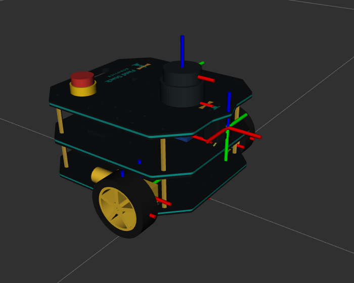
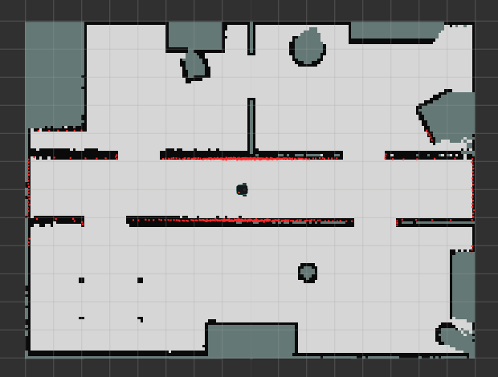

# Caretta

Caretta is our first robot: a small, open source indoor robot that runs ROS 2.

<p align="center"></p>

| Part | Purpose |
|---|---|
| Two wheels | Differential drive, up to 0.3 m/s |
| 2D LiDAR | Sees the obstacles around the robot |
| IMU | Measures rotation for better localization |
| Camera | Shows what is in front |
| E-stop | Emergency stop button for safety |
| Current sensor | Measures battery current for the battery management system |

## 1. Install

Install Caretta on your computer, then drive, map and navigate in Gazebo, step by step.
The same guide is on our website: [Try Caretta](https://fieldstackrobotics.com/try.html).

```bash
git clone -b humble https://github.com/field-stack-robotics/caretta.git
```

**Requirements:**

- Ubuntu 22.04
- [ROS 2 Humble](https://docs.ros.org/en/humble/Installation.html)

> [!NOTE]
> Using a different system? A Docker version will be available soon.

First, install the tools we need:

```bash
sudo apt install python3-rosdep python3-colcon-common-extensions git \
  ros-humble-teleop-twist-keyboard
```

- `rosdep`: installs the dependencies
- `colcon`: builds the packages
- `git`: downloads the repos
- `teleop_twist_keyboard`: drives the robot with the keyboard

### 1.1 Download the repos

Create a workspace folder and go into its `src` folder:

```bash
mkdir -p ~/caretta_ws/src
cd ~/caretta_ws/src
```

Download the robot repo:

```bash
git clone -b humble https://github.com/field-stack-robotics/caretta.git
```

Then download the simulation repo:

```bash
git clone -b humble https://github.com/field-stack-robotics/caretta_simulator.git
```

<details>
<summary>Terminal output</summary>

```console
user@ubuntu:~/caretta_ws/src$ git clone -b humble https://github.com/field-stack-robotics/caretta_simulator.git
Cloning into 'caretta_simulator'...
remote: Enumerating objects: 97, done.
remote: Counting objects: 100% (97/97), done.
remote: Compressing objects: 100% (53/53), done.
Receiving objects: 100% (97/97), 169.23 KiB | 1.45 MiB/s, done.
Resolving deltas: 100% (38/38), done.
```

</details>

### 1.2 Build the workspace

Set up `rosdep`. You only need this once per computer, so skip it if it says "already exists":

```bash
sudo rosdep init
```

Go back to the workspace, update the package list and install everything the repos need:

```bash
cd ~/caretta_ws
rosdep update
rosdep install --from-paths src --ignore-src -y
```

Now, build the packages:

```bash
colcon build
```

<details>
<summary>Terminal output</summary>

```console
user@ubuntu:~/caretta_ws$ colcon build
Starting >>> caretta_control
Starting >>> caretta_description
Starting >>> caretta_localization
Starting >>> caretta_rviz_plugins
Starting >>> caretta_navigation
Finished <<< caretta_control [1.00s]
Finished <<< caretta_navigation [1.01s]
Finished <<< caretta_localization [1.03s]
Finished <<< caretta_description [1.05s]
Starting >>> caretta_gazebo
Finished <<< caretta_gazebo [0.71s]
Finished <<< caretta_rviz_plugins [16.7s]
Starting >>> caretta_navigation_outdoor
Finished <<< caretta_navigation_outdoor [1.06s]

Summary: 7 packages finished [18.1s]
```

</details>

Finally, source the workspace so ROS 2 can find the packages:

```bash
source install/setup.bash
```

> [!CAUTION]
> **Having a problem?** Ask us on [Discord](https://discord.gg/NCBbzgu32).

## 2. Start the simulation

### 2.1 Launch Gazebo

Start Gazebo and RViz with the house world:

```bash
ros2 launch caretta_gazebo gazebo.launch.py rviz:=true world:=caretta_house
```

<details>
<summary>Terminal output</summary>

```console
user@ubuntu:~/caretta_ws$ ros2 launch caretta_gazebo gazebo.launch.py rviz:=true world:=caretta_house
[INFO] [ign gazebo-1]: process started
[INFO] [robot_state_publisher-2]: process started
[INFO] [parameter_bridge-3]: process started
[INFO] [image_bridge-4]: process started
[INFO] [rviz2-5]: process started
[INFO] [ekf_node-6]: process started
...
[create-7] [INFO] [ros_gz_sim]: Requested creation of entity.
[create-7] [INFO] [ros_gz_sim]: OK creation of entity.
[INFO] [twist_mux-9]: process started
[ign gazebo-1] [INFO] [gz_ros2_control]: System Successfully configured!
[spawner-8] [INFO] [spawner_joint_state_broadcaster]: Configured and activated joint_state_broadcaster
[spawner-8] [INFO] [spawner_joint_state_broadcaster]: Configured and activated diff_drive_controller
```

</details>

You can also try the other worlds, `caretta_office` and `caretta_outdoor`. Without `world:=` you get an empty world.

<table>
  <tr>
    <td align="center"><br><code>caretta_house</code></td>
    <td align="center"><br><code>caretta_office</code></td>
    <td align="center"><br><code>caretta_outdoor</code></td>
  </tr>
</table>

### 2.2 Drive with the keyboard

Open a new terminal, source the workspace and start the keyboard teleop:

```bash
source ~/caretta_ws/install/setup.bash
ros2 run teleop_twist_keyboard teleop_twist_keyboard \
  --ros-args -r cmd_vel:=cmd_vel_teleop
```

`i` drives forward, `j` and `l` turn, `k` stops. Keep this terminal selected while you drive.

### 2.3 Emergency stop

Stop the robot. Every velocity command (teleop and Nav2) is blocked:

```bash
ros2 topic pub --rate 10 /e_stop std_msgs/msg/Bool "data: true"
```

Wait until the robot stops, then press **Ctrl+C**. It stays stopped. Do not use `--once`: the single message can get lost.

Release it, the robot accepts commands again:

```bash
ros2 topic pub --times 10 --rate 10 /e_stop std_msgs/msg/Bool "data: false"
```

## 3. SLAM

Caretta draws a map while you drive it.

https://github.com/user-attachments/assets/785c92c8-7106-4adf-b804-7b17f542cdbf

### 3.1 Build the map

Stop the simulation and the teleop with **Ctrl+C**. Start Gazebo again without RViz, because SLAM opens its own:

```bash
ros2 launch caretta_gazebo gazebo.launch.py world:=caretta_house
```

Open a new terminal and start SLAM:

```bash
source ~/caretta_ws/install/setup.bash
ros2 launch caretta_navigation slam.launch.py use_sim_time:=true
```

<details>
<summary>Terminal output</summary>

```console
user@ubuntu:~$ ros2 launch caretta_navigation slam.launch.py use_sim_time:=true
[INFO] [async_slam_toolbox_node-1]: process started
[INFO] [rviz2-2]: process started
[async_slam_toolbox_node-1] [INFO] [slam_toolbox]: Using solver plugin solver_plugins::CeresSolver
[async_slam_toolbox_node-1] Registering sensor: [Custom Described Lidar]
```

</details>

Open a third terminal and drive slowly through every room:

```bash
source ~/caretta_ws/install/setup.bash
ros2 run teleop_twist_keyboard teleop_twist_keyboard \
  --ros-args -r cmd_vel:=cmd_vel_teleop
```

The map grows in RViz as you drive. White is free space, black is an obstacle:

<p align="center"></p>

### 3.2 Save the map

Keep SLAM running. Open a new terminal, go to the workspace and save the map:

```bash
cd ~/caretta_ws
source install/setup.bash
ros2 run nav2_map_server map_saver_cli -f my_map \
  --ros-args -p use_sim_time:=true
```

<details>
<summary>Terminal output</summary>

```console
user@ubuntu:~/caretta_ws$ ros2 run nav2_map_server map_saver_cli -f my_map --ros-args -p use_sim_time:=true
[INFO] [map_saver]: Saving map from 'map' topic to 'my_map' file
[INFO] [map_io]: Received a 160 X 120 map @ 0.05 m/pix
[INFO] [map_io]: Writing map occupancy data to my_map.pgm
[INFO] [map_io]: Writing map metadata to my_map.yaml
[INFO] [map_saver]: Map saved successfully
```

</details>

You now have two files:

- `my_map.pgm`: the picture of the map
- `my_map.yaml`: its resolution and origin

## 4. Navigation

Caretta drives to a goal on its own, on the map you just saved.

https://github.com/user-attachments/assets/4680e2b5-b064-4d4f-bdd8-f7bec1c210fa

### 4.1 Start Nav2

Stop everything with **Ctrl+C** and start Gazebo again, so the robot is back at the start of the map:

```bash
ros2 launch caretta_gazebo gazebo.launch.py world:=caretta_house
```

Open a new terminal and start navigation with your map. It starts AMCL, Nav2 and RViz:

```bash
source ~/caretta_ws/install/setup.bash
ros2 launch caretta_navigation navigation.launch.py use_sim_time:=true \
  map:=$HOME/caretta_ws/my_map.yaml
```

<details>
<summary>Terminal output</summary>

```console
user@ubuntu:~$ ros2 launch caretta_navigation navigation.launch.py use_sim_time:=true map:=$HOME/caretta_ws/my_map.yaml
[INFO] [map_server-1]: process started
[INFO] [amcl-2]: process started
[INFO] [controller_server-4]: process started
[INFO] [planner_server-6]: process started
[INFO] [bt_navigator-8]: process started
[INFO] [rviz2-12]: process started
...
[lifecycle_manager-3] [INFO] [lifecycle_manager_localization]: Managed nodes are active
[lifecycle_manager-11] [INFO] [lifecycle_manager_navigation]: Managed nodes are active
```

</details>

No map yet? Leave out `map:=...` to use the house map that comes with the repo.

### 4.2 Send a goal

In RViz, click **2D Goal Pose**, then click on the map where Caretta should go and drag to set the direction.

<details>
<summary>Terminal output</summary>

```console
[bt_navigator-8] [INFO] [bt_navigator]: Begin navigating from current location (-0.00, -0.00) to (2.00, 1.20)
[controller_server-4] [INFO] [controller_server]: Received a goal, begin computing control effort.
[controller_server-4] [INFO] [controller_server]: Reached the goal!
[bt_navigator-8] [INFO] [bt_navigator]: Goal succeeded
```

</details>

> [!NOTE]
> The keyboard always wins. Start the teleop to take over at any time.

> [!CAUTION]
> **Having a problem?** Ask us on [Discord](https://discord.gg/NCBbzgu32).

## 5. More

### 5.1 View the model

See the robot in RViz, without Gazebo:

```bash
ros2 launch caretta_description display.launch.py
```

### 5.2 Localization only

Run AMCL on the saved map, without Nav2. Do not run it together with SLAM: both publish the TF `map` -> `odom`.

Start Gazebo:

```bash
ros2 launch caretta_gazebo gazebo.launch.py world:=caretta_house
```

Open a new terminal and start AMCL:

```bash
source ~/caretta_ws/install/setup.bash
ros2 launch caretta_navigation amcl.launch.py use_sim_time:=true
```

If the robot gets lost, set its pose in RViz with **2D Pose Estimate**, or spread the particles over the whole map and drive a bit:

```bash
ros2 service call /reinitialize_global_localization std_srvs/srv/Empty
```

### 5.3 Outdoor navigation

> [!WARNING]
> Work in progress. GPS navigation is still being developed and may change.

Nav2 without a map, with dual-antenna RTK GPS. Start the outdoor field:

```bash
ros2 launch caretta_gazebo gazebo.launch.py world:=caretta_outdoor gps:=true
```

Open a new terminal and start GPS navigation (Nav2 and RViz):

```bash
source ~/caretta_ws/install/setup.bash
ros2 launch caretta_navigation_outdoor gps_navigation.launch.py use_sim_time:=true
```

Give a goal in the RViz **GpsGoal** panel (latitude, longitude) or with **2D Goal Pose**.

## 6. Reference

### 6.1 Workspace layout

```
caretta_ws/
└── src/
    ├── caretta/              # the robot
    │   ├── caretta_description/   # model: URDF, meshes, sensors
    │   ├── caretta_control/       # controllers, twist_mux
    │   ├── caretta_localization/  # EKF (robot_localization)
    │   ├── caretta_navigation/    # indoor: SLAM (slam_toolbox), maps, AMCL, Nav2
    │   ├── caretta_navigation_outdoor/  # outdoor: dual-antenna RTK GPS, GPS localization, Nav2
    │   └── caretta_rviz_plugins/  # RViz GpsGoal panel (latitude/longitude goal)
    └── caretta_simulator/    # Gazebo world and launch
        └── caretta_gazebo/
```

### 6.2 Topics

Sensors:

- `/scan`: LiDAR
- `/camera/image_raw`: camera
- `/imu`: IMU (BNO055, 100 Hz)
- `/diff_drive_controller/odom`: wheel odometry
- `/map`: occupancy grid, from SLAM or from the saved map (TF `map` -> `odom` from SLAM or AMCL)
- `/amcl_pose`, `/particle_cloud`: AMCL estimate and particles
- `/gps/front/fix`, `/gps/rear/fix`: the two GPS antennas (outdoor, `gps:=true`)
- `/gps/heading`: heading from the two antennas; `/odometry/global`: robot in the map from GPS
- `/odometry/filtered`: EKF output, wheel odometry + IMU (also the TF `odom` -> `caretta_base_footprint`)

Velocity commands (`twist_mux` picks one; the higher priority wins):

- `/cmd_vel_teleop`: keyboard, priority 100
- `/cmd_vel`: autonomous navigation (Nav2), priority 10
- `/e_stop`: `std_msgs/Bool`, `true` stops the robot

## 7. License

Apache-2.0
