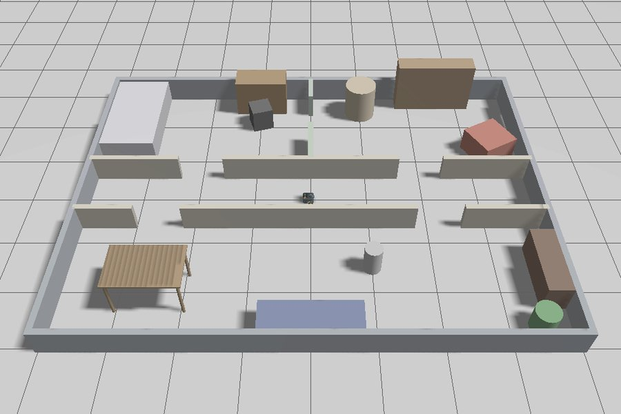
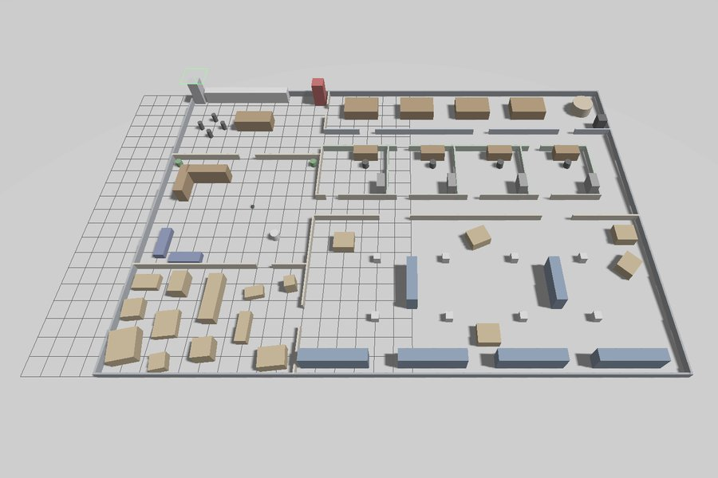
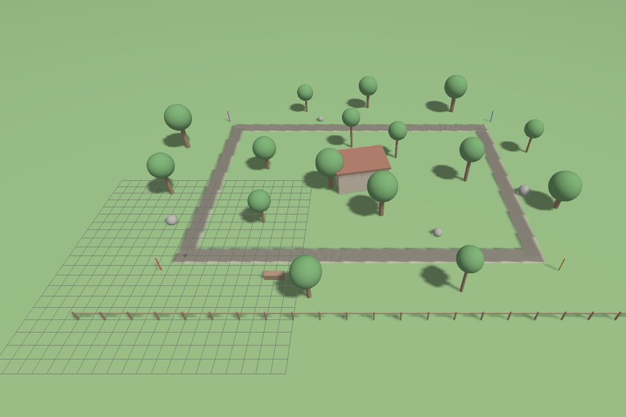

# Caretta

https://github.com/user-attachments/assets/5369956b-e824-4f32-9cb9-5ca2b4d7fa6d

```bash
git clone -b humble https://github.com/field-stack-robotics/caretta.git
```

FS-1 Caretta differential-drive robot by Field Stack Robotics.

Tested on Ubuntu 22.04, ROS 2 Humble, Ignition Gazebo Fortress.

## 1. Setup

Install [ROS 2 Humble](https://docs.ros.org/en/humble/Installation.html) first.

### 1.1 Install the tools

Install rosdep (installs package dependencies), colcon (builds the workspace) and git (downloads the repos):

```bash
sudo apt install python3-rosdep python3-colcon-common-extensions git
```

Install the keyboard teleop, used to drive the robot:

```bash
sudo apt install ros-humble-teleop-twist-keyboard
```

### 1.2 Create the workspace

Create the workspace folder. All packages go inside `src/`:

```bash
mkdir -p ~/caretta_ws/src
```

Go into `src/`:

```bash
cd ~/caretta_ws/src
```

### 1.3 Clone the repos

Download the robot (model and control):

```bash
git clone -b humble https://github.com/field-stack-robotics/caretta.git
```

Download the Gazebo simulation (skip it if you don't use Gazebo):

```bash
git clone -b humble https://github.com/field-stack-robotics/caretta_simulator.git
```

### 1.4 Install the dependencies

Go back to the workspace root:

```bash
cd ~/caretta_ws
```

Set up rosdep. This is needed only once per computer; skip it if it says "already exists":

```bash
sudo rosdep init
```

Download the latest list of ROS packages:

```bash
rosdep update
```

Install every package the repos need (Gazebo, ros2_control, ...):

```bash
rosdep install --from-paths src --ignore-src -y
```

### 1.5 Build

Build all packages in `src/`. This creates the `build/`, `install/` and `log/` folders:

```bash
colcon build
```

Load the built packages into this terminal so `ros2` can find them:

```bash
source install/setup.bash
```

Run `source ~/caretta_ws/install/setup.bash` in every new terminal.

## 2. Workspace layout

```
caretta_ws/
└── src/
    ├── caretta/              # the robot
    │   ├── caretta_description/   # model: URDF, meshes, sensors
    │   ├── caretta_control/       # controllers, twist_mux
    │   ├── caretta_localization/  # EKF (robot_localization)
    │   ├── caretta_navigation/    # indoor: SLAM (slam_toolbox), maps, AMCL, Nav2
    │   ├── caretta_navigation_outdoor/  # outdoor: dual-antenna RTK GPS, GPS localization, Nav2
    │   └── caretta_rviz_plugins/  # RViz GpsGoal panel (latitude/longitude goal)
    └── caretta_simulator/    # Gazebo world and launch
        └── caretta_gazebo/
```

## 3. Run

### 3.1 View the Model

View the model in RViz:

```bash
ros2 launch caretta_description display.launch.py
```

### 3.2 Start Simulation

Run the simulation in Gazebo:

```bash
ros2 launch caretta_gazebo gazebo.launch.py rviz:=true
```

The default world is empty. Pick another one with `world:=<name>`:

- `caretta_house`: corridor and three rooms (SLAM)
- `caretta_office`: 30 x 20 m building (harder SLAM)
- `caretta_outdoor`: open field (GPS)

<table>
  <tr>
    <td align="center"><br><code>caretta_house</code></td>
    <td align="center"><br><code>caretta_office</code></td>
    <td align="center"><br><code>caretta_outdoor</code></td>
  </tr>
</table>

```bash
ros2 launch caretta_gazebo gazebo.launch.py rviz:=true world:=caretta_house
```

Open a new terminal and run the command below:

```bash
ros2 run teleop_twist_keyboard teleop_twist_keyboard \
  --ros-args -r cmd_vel:=cmd_vel_teleop
```

### 3.3 Emergency Stop

`true` stops the robot: every velocity command (teleop and Nav2) is blocked until you release it:

```bash
ros2 topic pub --rate 10 /e_stop std_msgs/msg/Bool "data: true"
```

Wait until the robot stops, then press **Ctrl+C**. It stays stopped. Do not use `--once`: the single message can get lost.

`false` releases it, the robot accepts commands again:

```bash
ros2 topic pub --times 10 --rate 10 /e_stop std_msgs/msg/Bool "data: false"
```

## 4. SLAM: Build a Map

https://github.com/user-attachments/assets/785c92c8-7106-4adf-b804-7b17f542cdbf

Start Gazebo without RViz (SLAM opens its own RViz with the map):

```bash
ros2 launch caretta_gazebo gazebo.launch.py world:=caretta_house
```

Start SLAM (slam_toolbox), in a second terminal:

```bash
ros2 launch caretta_navigation slam.launch.py use_sim_time:=true
```

Drive slowly through every room (teleop above, third terminal), then save the map while SLAM still runs:

```bash
ros2 run nav2_map_server map_saver_cli -f src/caretta/caretta_navigation/maps/caretta_house \
  --ros-args -p use_sim_time:=true
```

## 5. Localization

Localize on the saved map with AMCL. Do not run it together with SLAM: both publish the TF `map` -> `odom`.

```bash
ros2 launch caretta_gazebo gazebo.launch.py world:=caretta_house
ros2 launch caretta_navigation amcl.launch.py use_sim_time:=true
```

The robot starts at the map origin, so AMCL knows where it is. If it gets lost, set the pose in RViz with
**2D Pose Estimate**, or spread the particles over the whole map and drive a bit:

```bash
ros2 service call /reinitialize_global_localization std_srvs/srv/Empty
```

## 6. Indoor Navigation

https://github.com/user-attachments/assets/4680e2b5-b064-4d4f-bdd8-f7bec1c210fa

Starts AMCL, Nav2 and RViz together (do not start `amcl.launch.py` or SLAM as well):

```bash
ros2 launch caretta_gazebo gazebo.launch.py world:=caretta_house
ros2 launch caretta_navigation navigation.launch.py use_sim_time:=true
```

Give a goal in RViz with **2D Goal Pose**. The keyboard teleop always wins over Nav2, and `/e_stop` stops both.

## 7. Outdoor Navigation

> **Work in progress.** GPS navigation is still being developed and may change.

Nav2 without a map, with dual-antenna RTK GPS. Start the outdoor field:

```bash
ros2 launch caretta_gazebo gazebo.launch.py world:=caretta_outdoor gps:=true
```

Open a new terminal and start GPS navigation (Nav2 and RViz):

```bash
ros2 launch caretta_navigation_outdoor gps_navigation.launch.py use_sim_time:=true
```

Give a goal in the RViz **GpsGoal** panel (latitude, longitude) or with **2D Goal Pose**.

## 8. Topics

Sensors:

- `/scan`: LiDAR
- `/camera/image_raw`: camera
- `/imu`: IMU (BNO055, 100 Hz)
- `/diff_drive_controller/odom`: wheel odometry
- `/map`: occupancy grid, from SLAM or from the saved map (TF `map` -> `odom` from SLAM or AMCL)
- `/amcl_pose`, `/particle_cloud`: AMCL estimate and particles
- `/gps/front/fix`, `/gps/rear/fix`: the two GPS antennas (outdoor, `gps:=true`)
- `/gps/heading`: heading from the two antennas; `/odometry/global`: robot in the map from GPS
- `/odometry/filtered`: EKF output, wheel odometry + IMU (also the TF `odom` -> `caretta_base_footprint`)

Velocity commands (`twist_mux` picks one; the higher priority wins):

- `/cmd_vel_teleop`: keyboard, priority 100
- `/cmd_vel`: autonomous navigation (Nav2), priority 10
- `/e_stop`: `std_msgs/Bool`, `true` stops the robot

## 9. License

Apache-2.0
